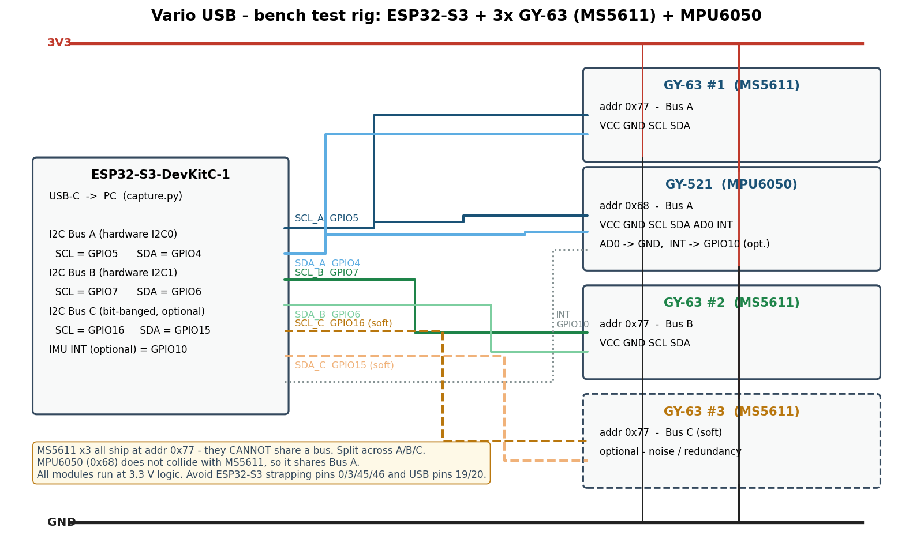

# Bench Test Rig — Schematic & Pinout

**Status:** ready to wire · 2026-10-21
**Board assumed:** ESP32-S3-DevKitC-1. GPIO numbers below are what matter; if your
board is a different ESP32-S3 devkit (XIAO, Feather, custom), remap freely but keep
the *constraints* section.

---

## 1. Bill of materials (all on hand)

| Qty | Module | Role | I²C address |
|-----|--------|------|-------------|
| 1 | ESP32-S3-DevKitC-1 | DAQ + USB logging | — |
| 3 | GY-63 (MS5611 barometer) | pressure ×3, noise/averaging study | 0x77 (all three — see §4) |
| 1 | GY-521 (MPU6050 IMU) | accel + gyro, fusion study | 0x68 (AD0→GND) |

Bench roles only, per ADR-002/ADR-011: MS5611 stands in for the BMP581/BMP585
product decision, MPU6050 stands in for the LSM6DS3-class fusion decision.

## 2. Pinout — ESP32-S3 side

| Function | GPIO | Notes |
|----------|------|-------|
| I2C Bus A — SDA | GPIO4 | hardware I2C0 · MS5611 #1 + MPU6050 |
| I2C Bus A — SCL | GPIO5 | hardware I2C0 |
| I2C Bus B — SDA | GPIO6 | hardware I2C1 · MS5611 #2 |
| I2C Bus B — SCL | GPIO7 | hardware I2C1 |
| I2C Bus C — SDA | GPIO15 | bit-banged · MS5611 #3 (optional) |
| I2C Bus C — SCL | GPIO16 | bit-banged |
| IMU INT (optional) | GPIO10 | data-ready interrupt, fusion tests only |
| 3V3 | 3V3 header | feeds all modules (see §5) |
| GND | GND header | common ground |

### Pin constraints (why these GPIOs)

- **Avoid strapping pins** GPIO0, GPIO3, GPIO45, GPIO46 — they select boot mode /
  JTAG source / flash voltage at reset. A sensor pulling one of these can brick boot.
- **Avoid GPIO19/GPIO20** — wired to the native USB D−/D+. We need USB for logging.
- **Avoid GPIO26–32** on N8R8 (octal PSRAM) boards — used by the flash/PSRAM bus.
- Everything chosen above is a plain, safe, input-capable GPIO.

## 3. Module wiring tables

### GY-63 #1 (MS5611) → I2C Bus A

| GY-63 pin | Connect to |
|-----------|------------|
| VCC | 3V3 rail |
| GND | GND rail |
| SCL | GPIO5 |
| SDA | GPIO4 |
| CSB | leave unconnected (see §4) |
| PS | leave unconnected (pulled high on board → I²C mode) |

### GY-521 (MPU6050) → I2C Bus A (shares the bus, no address clash)

| GY-521 pin | Connect to |
|------------|------------|
| VCC | 3V3 rail |
| GND | GND rail |
| SCL | GPIO5 |
| SDA | GPIO4 |
| AD0 | GND → address 0x68 (tie to 3V3 for 0x69) |
| INT | GPIO10 (optional; skip for T-001…T-003) |
| XDA / XCL | leave unconnected (aux bus, unused) |

### GY-63 #2 (MS5611) → I2C Bus B

| GY-63 pin | Connect to |
|-----------|------------|
| VCC | 3V3 rail |
| GND | GND rail |
| SCL | GPIO7 |
| SDA | GPIO6 |

### GY-63 #3 (MS5611, optional) → I2C Bus C (bit-banged)

| GY-63 pin | Connect to |
|-----------|------------|
| VCC | 3V3 rail |
| GND | GND rail |
| SCL | GPIO16 |
| SDA | GPIO15 |

## 4. The address problem (read before wiring)

All three GY-63 modules default to **0x77** — the breakout hardwires the MS5611 CSB
pin, so you cannot put two of them on one bus. Hence the three-bus layout:

- Bus A: MS5611 #1 (0x77) + MPU6050 (0x68) — no collision, one hardware bus.
- Bus B: MS5611 #2 (0x77).
- Bus C: MS5611 #3 (0x77) — bit-banged, only needed for the 3-sensor study (T-003).

**First firmware task:** run an I²C scan and record which address each module
actually answers at. If any GY-63 answers at **0x76**, its CSB is pulled low on that
board — and two boards with *different* addresses *can* share a bus. Verify, don't
assume: clone boards vary.

**MPU9250/6500 4-pin board:** no INT pin exposed, and clones of these are often
relabeled (read WHO_AM_I — expect 0x71 for MPU9250, 0x70 for MPU6500). Keep it as a
later swap-in comparison on Bus B; MPU6050 is the primary IMU.

## 5. Power & signal integrity notes

- **Feed 3V3, not 5V.** Both module types have onboard LDOs and I²C pull-ups. Powering
  from 3V3 keeps the pull-ups at 3V3 and removes a failure mode. (GY-63 accepts 3–5V,
  GY-521 accepts 3–5V — but 3V3 everywhere is the clean choice.)
- All four modules + ESP32-S3 from one USB port: total current ≈ 150 mA worst case —
  no problem.
- **Keep I²C wires short** (<20 cm) for the hardware buses; the bit-banged bus is
  tolerant but slow — fine at 100 kHz.
- Add one **100 µF capacitor** across the 3V3 rail near the sensor cluster if you see
  brownouts when both radios/USB renegotiate — usually unnecessary on devkits.
- Common-ground everything through the rail; don't daisy-chain module GNDs.

## 6. Physical bring-up checklist (before any firmware)

1. Continuity-check every wire against the tables above.
2. Power on USB only — confirm no module gets hot (LDO backwards = instant heat).
3. I²C scan: expect `0x77` on bus A and B (and C if wired), `0x68` on bus A.
4. Only then flash firmware.

## 6b. Bring-up results (2026-10-21, I²C scan T-000)

Verified on the bench — **use these addresses in firmware, not the §1 assumptions**:

| Module | Schematic assumed | Actually answers | Consequence |
|--------|-------------------|------------------|-------------|
| GY-63 #1 (Bus A) | 0x77 | **0x76** | This clone pulls CSB low → it *can* share a bus with a 0x77 unit. Confirms the §7 dual-baro-on-one-bus plan works even with GY-63s if you mix clones carefully. |
| GY-63 #2 (Bus B) | 0x77 | 0x77 ✓ | — |
| GY-63 #3 (Bus C) | 0x77 | not wired | Optional; wire it before T-003. |
| MPU6050 (Bus A) | 0x68 (AD0→GND) | **0x69** | AD0 is tied to 3V3 on this module. WHO_AM_I reads 0x68 as expected — genuine MPU6050, not a relabeled clone. |

PROM[0] sanity: 0x0878 (Bus A) / 0x0884 (Bus B) — both chips alive and reading.

## 7. Notes for the China PCB decision

This rig exists to answer the PCB questions **before** you pay for a board:

- **T-001…T-003 output** → is a single BMP581-class sensor enough, or does dual-barometer
  averaging (ADR-002) earn its $2.6?
- **T-008 replay output** → is the IMU (ADR-011 LSM6DS3) worth populating, or baro-only
  CV-Kalman (ADR-006) sufficient?

Layout lessons to carry into the EasyEDA design later:

- On a custom PCB, the MS5611 **CSB pin is a real net** — tie sensor #2's CSB low to get
  0x76 and both barometers share one bus (no mux needed). This rig can't test that
  because GY-63 hardwires CSB; keep it in mind for the schematic.
- Product sensors are BMP581/BMP585 (I²C addresses 0x46/0x47 per Bosch defaults) — no
  address collision either way; dual-barometer on one bus is free on the PCB.
- Put the pressure port(s) and IMU far from the MCU/USB-switching regulators; the
  elevator + thermal-disturbance tests (T-004) tell you how far that needs to be.
- JLCPCB parts availability for BMP581/BMP585/LSM6DS3TR-C should be confirmed at
  schematic time (see USB_C_Instant_Vario docs/RESEARCH.md) — this bench work does not
  block that check, so start it in parallel.
